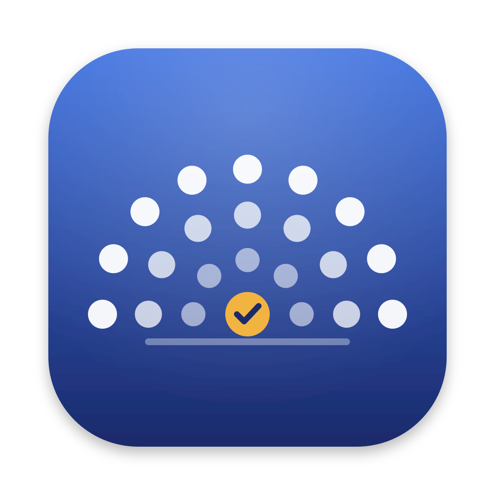
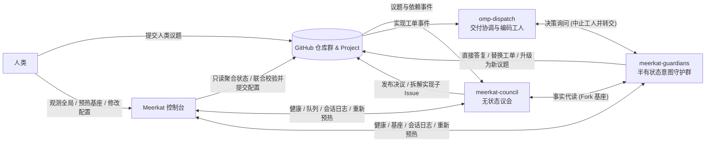

# Meerkat

Meerkat 是一套以 GitHub 仓库与 GitHub Project 为唯一状态源的多 Agent 软件项目管理与自动交付系统，本仓库是该系统的跨平台全局控制台（基于 [NSH](https://nsh.dev) 构建，同一套 Rust 代码可编译为 macOS 原生应用与 WebAssembly 静态站点）。

---

## 为什么需要 Meerkat

当多 Agent 协作从“单次写代码”延伸到“需求审议、架构决策、跨仓库检索与持续交付”时，工程实践通常会撞上两个失效极端：

1. **常驻会话的上下文腐化**：传统多 Agent 方案往往让守护进程维持长生命周期会话，靠群聊或消息总线协调所有事务。随着读取的代码、设计文档与历史讨论不断累积，上下文被迫反复压缩（compact），Agent 会逐渐遗忘原始业务约束、偏离角色边界，甚至需要额外部署“巡检 Agent”去监督其他 Agent 是否罢工或越权。
2. **纯无状态查询的读取爆炸**：若为了消除上下文污染而改成彻底的“即用即丢”，每次审议议题或回答编码工人的疑问都要从零扫描代码库与设计书，不仅 Token 成本与首字延迟居高不下，针对代码与文档设计的外部向量记忆库也极难保持行级精确度。

Meerkat 通过重新划分状态归属与会话生命周期来解开这一矛盾：**所有业务状态落盘到 GitHub，所有行动会话用完即毁，唯有代码与设计认知通过“预热基座 + 会话分叉（Fork）”维持半有状态复用。**

---

## 核心机制



### 1. GitHub 即唯一数据库，行动会话一次性运行

系统不设私有业务数据库。议程议题（Agenda Issue）、多席位表决记录、守护者答复、实现工单（Implementation Issue）以及任务间的阻塞关系，全部以 GitHub Issue、结构化评论标记与 Project 字段的形式持久化。

无论是议会审议还是守护者答复，外部守护进程每次只针对单个任务拉起全新的无头 `omp` 会话，并通过配套插件锁死该会话的完成条件（如提交决策表、投出选票、返回代码事实或答复工单）——未调用目标工具前不允许提前停止，调用成功后进程立即销毁。由于不存在跨任务的常驻对话，角色不会因上下文堆积而失真，也彻底省去了内部治理与巡检席位。

### 2. 半有状态意图守护：预热基座与 `--fork` 缓存复用

议会席位专注方案审议与投票，不直接翻阅庞大的业务代码库；编码工人在执行工单时遇到未决的设计边界，也不自行揣测意图。所有针对代码仓、设计仓与工具链定制仓的深度读取，均收口到独立的**意图守护群（`meerkat-guardians`）**：

- **预热基座（Base Session）**：守护进程按“守护者 × 仓库 × 模型”预先启动无头会话，通读目标仓库的结构、入口与设计规范后挂起就绪。
- **代读分叉（Proxy Read）**：议会席位需要核对某处实现或设计事实时，守护进程从对应模型的就绪基座直接 `--fork` 出子会话。子会话天然继承基座已建立的仓库认知并命中大模型 Prompt Cache，交回带精确文件与行号出处的事实后即刻销毁。
- **分级决策询问（Decision Ask）**：编码工人发起询问时，守护进程按问题复杂度（简单或复杂档位）从对应基座分叉出查询会话。属于既有设计边界内的问题由守护者直接回复原工单，或新建工单替换旧工单；涉及跨模块或产品级取舍的问题，则由守护者自动提炼并升级为议会的新议题。

### 3. DAG 议题调度、多席位制衡与人类议题抢占

**议会（`meerkat-council`）** 不设人工优先级字段，而是根据议题间的 `Blocked by` 关系构建有向无环图（DAG），自动找出前置条件已清零的就绪议题并召集临时审议小组：

- **四席位分工**：起草席负责拆解决策表（明确改什么、改哪里、怎么改及取舍）；独立技术审查席投赞成票或附可复现反例投反对票；原始意图守护席专门核对方案是否违背人类意图（拥有引用人类原话的一票否决权）；终局仲裁席对“分歧属于技术问题还是意图偏差”做分类裁决。
- **人类议题抢占**：人类在系统外直接提交的**人类议题（Human Issue）**拥有最高抢占权。一旦人类议题进入队列，议会立即中断所有在审的普通议题，优先审议人类议题；定案后，被人类决议推翻的旧议题直接标记为已取代（`Superseded`），未受波及的议题则从中断处恢复审议。
- **自动拆解交付**：决议通过后，议会自动在对应的目标代码仓库创建实现子 Issue，并在正文中注入指向该仓库工作目录的 `omp-dispatch` 启动链接。

### 4. 询问即中止的编码工人生命周期

**工人群（`omp-dispatch`）** 仅面向目标代码仓中的实现子 Issue 工作，无需阅读冗长的议会辩论过程。当工人在实现途中遇到需求歧义或架构阻塞并发起询问时，交付协调器将问题转交意图守护群，并**当场终止该工人会话**——既避免工人在等待期间空转消耗额度，也防止其带着未经确认的假设继续写代码。待守护者答复或议会决议落回 Issue 后，再按策略唤醒或重建工人完成 PR 交付。

---

## Meerkat 系列仓库

整个系统按职责拆分为独立仓库，各组件通过 GitHub 事件与轻量 HTTP 接口协同：

| 仓库 | 语言 / 技术栈 | 在系统中的角色 |
|---|---|---|
| **[`mouriya-s-lab/meerkat`](https://github.com/mouriya-s-lab/meerkat)**（本仓库） | Rust（NSH） | **全局控制台**：聚合展示 GitHub 与各守护进程状态，提供待办告警、议题 DAG、表决矩阵、实现时间线、精简决策日志、基座预热与多端配置联合校验提交。 |
| **[`mouriya-s-lab/meerkat-council`](https://github.com/mouriya-s-lab/meerkat-council)** | Go + TypeScript | **议会守护进程与 `omp` 插件**：接收 GitHub Webhook，维护议题 DAG 队列，按轮次召集无头 `omp` 席位执行起草、投票、仲裁、修订与实现子 Issue 发布。 |
| **[`mouriya-s-lab/meerkat-guardians`](https://github.com/mouriya-s-lab/meerkat-guardians)** | Go + TypeScript | **意图守护进程与 `omp` 插件**：管理预热基座会话，通过会话分叉服务议会代读请求与工人决策询问；同时提供共用的 `omprpc` 客户端包与确定性测试桩 `fake-omp`。 |
| **`omp-dispatch`** | TypeScript | **交付协调与编码工人群**：监听代码仓实现 Issue，驱动工人编写代码与提交 PR，并在工人发起询问时执行登记、转交与中止恢复。 |
| **[`mouriya-s-lab/meerkat-config`](https://github.com/mouriya-s-lab/meerkat-config)** | YAML / Docker | **部署实例配置与镜像构建**：集中存放议会、守护、控制台与交付协调的配置文件、Komodo Stack 定义及镜像发布脚本；模板见 [`meerkat-config-template`](https://github.com/mouriya-s-lab/meerkat-config-template)。 |
| **`meerkat-e2e-agenda` / `code` / `design`** | Go / Markdown | **端到端测试仓库群**：供本地开发与全链路验收演练议题审议、基座代读、工单询问与自动交付的测试目标仓库。 |

---

## 控制台功能（`mouriya-s-lab/meerkat`）

因为议会与意图守护群全程在容器内无头运行、不设聊天对话框，Meerkat 控制台承担了人类观测系统全局与执行人工干预的全部入口。界面支持中英文切换（`OMOMP_LANG=zh|en` 或跟随系统与浏览器语言）及浅色/深色主题，包含六个核心页面：

- **概览**：按后果严重度置顶列出需要人工介入的事项（审议失败的议题、不可达的服务、预热失败或过期的基座、异常终止的会话、升级为议题的工人询问、GitHub API 余量告警），并展示议会队列、24 小时会话分布与基座概览。
- **议题与议题详情**：支持以状态分组列表或依赖关系图（DAG）浏览全部人类议题与普通议题。点开任一议题可查看多轮修订轨迹、席位 × 决策行的投票矩阵（赞成、反对反例、意图否决引文、分类裁决）、前置与阻塞链路、派生的实现子 Issue，以及各席位会话的精简决策日志。
- **实现**：按等待状态（等答复、进行中、待办、完成）归组各代码仓库的实现 Issue，展开工人执行记录、每次询问与守护者答复/替换/升级议题的完整时间线及等待时长。
- **会话**：汇总议会与守护群的全部无头 `omp` 会话，按配置规则将原始会话记录提炼为可读的**决策日志**（保留关键插件工具调用与结论、折叠连续文件读取、隐藏内部思考过程、高亮 LLM 报错与自动重试）。
- **运行状况**：按仓库展示所有预热基座的就绪状态、分支或配置过期原因、最近预热结果与 24 小时分叉次数，支持人工一键触发**重新预热（Rewarm）**；同时监控各守护进程版本与 GitHub REST / GraphQL 速率余量。
- **配置**：在线浏览与编辑配置仓库（`meerkat-config`）的配置文件。编辑停顿后，控制台自动将候选内容分发给所有读取该文件的组件（议会、守护、交付协调与控制台自身）执行预校验，在对应行下内联标注错误键路径与原因；仅当全部读取方校验通过时才允许一键提交回配置分支。

---

## 构建与运行

控制台在启动时读取与议会、守护共用的配置目录（仓库内置的 `config.example/` 可直接用于本地运行）：

```text
<config dir>/
  meerkat/meerkat.yaml
  meerkat/theme.json
  shared/repos.yaml
  shared/project.yaml
```

### macOS 原生端

需安装 Rust 工具链与 Xcode Command Line Tools。GitHub 凭据取自环境变量 `GH_TOKEN`，未设置时自动调用 `gh auth token` 获取。

开发时用 [Relax](https://github.com/makepad/relax)（Rust JIT）直接从源码运行：函数首次调用时才编译，保存文件后改动的函数体热补丁进运行中的窗口，界面状态保留；改了类型布局、import、trait 或 impl 头时，Relax 提示需要重启。Relax 从构建它的 checkout 读取自带的 std，构建后保持该目录原位。`--allow-c` 让 Relax 用 cargo 构建依赖里编译 C 的构建脚本（`nsh-platform-apple`、`onig_sys`、`ring`）：

```sh
git clone https://github.com/makepad/relax <relax dir>
cargo build --release --manifest-path <relax dir>/Cargo.toml -p relax-runner --bin relax

MEERKAT_CONFIG_DIR=$PWD/config.example relax run --allow-c meerkat
relax test --allow-c meerkat -- --precompile --test-threads=1
```

`tests/` 的界面测试会改写进程环境变量，并在 10 秒内等待界面出现：`--test-threads=1` 让它们逐个运行，`--precompile` 让 Relax 在第一个测试开始前编译完测试会调用的函数，避免编译时间占用等待时限。

Relax 生成的代码比 rustc `--release` 慢，只用于编辑与运行循环；发布构建与打包仍由 rustc 完成（`nsh package`）。

打包独立 `Meerkat.app`（需安装 [`nsh`](https://nsh.dev/docs/installation.md)）：

```sh
nsh package --target macos -o /tmp/meerkat-macos
```

### Web 端

使用 `nsh` 编译静态站点（需 Homebrew `llvm` 与 `Cargo.lock` 中 `wasm-bindgen` 同版本的 `wasm-bindgen` CLI）后，通过仓库自带的 `deploy/Caddyfile` 启动同源反向代理（由代理注入 `GH_TOKEN`、提供 `/config/*` 只读挂载，并将写操作严格限制为目标配置仓库的单文件提交）：

```sh
PATH=/opt/homebrew/opt/llvm/bin:$PATH nsh package --target web -o /tmp/meerkat-web

LISTEN=:8088 SITE_DIR=/tmp/meerkat-web/Meerkat CONFIG_DIR=$PWD/config.example \
  GH_TOKEN=$(gh auth token) CONFIG_REPO=mouriya-s-lab/meerkat-config \
  COUNCIL_URL=http://127.0.0.1:7421 GUARDIANS_URL=http://127.0.0.1:7410 \
  DISPATCH_URL=http://127.0.0.1:47593 \
  caddy run --config deploy/Caddyfile --adapter caddyfile
```
